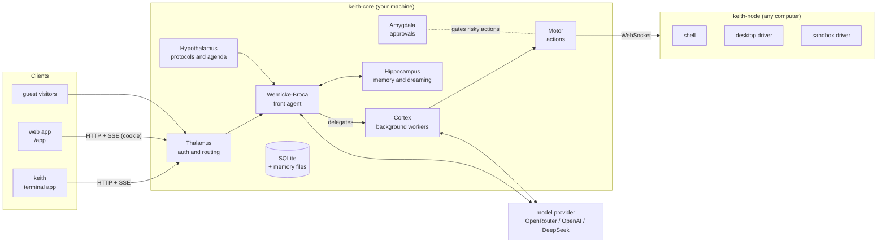

<div align="center">

# Keith

### Our humanized personal assistant.

*Jarvis belongs to Tony Stark. Keith belongs to you.*

[](LICENSE)
[](https://bun.sh)
[](https://www.typescriptlang.org)
[](https://github.com/viandwi24/eharness)


[Why Keith](#why-keith) · [Quick start](#quick-start) · [Features](#features) · [How it works](#how-it-works) · [Built on eharness](#built-on-eharness) · [Guide](docs/guide.md) · [License](#license)

</div>

---

Keith is a personal assistant you run yourself. It lives on a machine you own, keeps its memory and your conversations there, talks
to the model provider you choose, and does real work on the computers you pair with it, always asking before anything risky. It is
built like a person: it listens, hands work to helpers, remembers what matters, sleeps on it, and gets back to you in your own language.

## Why Keith

### 🗣️ Speaks your language
Write to Keith in any language and it answers in that language, or in the one you set for yourself. Work it hands to its helpers is
briefed in English, the language models follow best, and the result comes back in yours: ask for research in Indonesian and the
report is written in Indonesian.

### 🧠 Works the way people do
Keith is organised like a brain. A front desk listens and answers fast, specialists work in the background while you keep talking,
memory keeps each person's facts, and every night a *dreaming* pass reviews the day, keeps what lasts and lets go of the rest. Risky
actions wait for a human, the way a good assistant checks before signing in your name.

### 🧩 Grows with plugins
Plugins add tools, storage and their own screens in the terminal app through a small host contract; notes and reminders ship as
examples. Node drivers add new abilities to a machine with a typed driver SDK.

### 🌐 Clients and nodes expand your reach
Talk to Keith from the terminal app or the web app (phone included) on any device you sign in from. Pair any machine as a node and Keith can act there: run commands,
see and use the desktop, or run code in a disposable sandbox. Keith knows which of your clients is active and reaches you where you are.

## Features

| | |
| --- | --- |
| **Talks and delegates** | A fast front agent answers you and hands long work (research, several steps, a machine task) to background workers. You keep chatting while they run, and Keith tells you the result in its own words. |
| **Remembers each person** | Every person has their own memory: plain Markdown files you can read and edit. The nightly dreaming pass proposes changes you can apply or undo. |
| **Acts on your machines** | Commands, screenshots, desktop input and sandboxed code on paired nodes; every risky action waits for the owner's approval. |
| **Made for a household** | One owner and any number of members, each with their own chat, memory, files and optional spending cap. Members never see each other's data, and the owner's reads of a member's data are audited. |
| **Works together** | Shared rooms put several people in one conversation with the same Keith, with room-only tools and confirmations for anything personal. |
| **Takes the initiative, within limits** | Protocols are standing rules and reminder ladders that run on their own; a personal agenda keeps your meetings; nothing new starts until a person confirms it. |
| **Has a character** | One versioned persona (butler, friend, professional, or your own), plus per-person style: how to address you, language, brevity, formality, gentle topics. |
| **Keeps costs in check** | A monthly budget with per-person caps and a per-turn cap, prompt caching on providers that support it, and a log of every model call with its figures. |
| **Lets guests in, safely** | An optional guest mode serves visitors without an account on a priced model, with zones, daily caps and a kill switch. |
| **Never loses the thread** | Turns survive a dropped connection and a restart, `/new` saves what matters to memory before it starts fresh, and backups restore the whole data folder. |
| **Plans for the worst** | If the owner goes silent for weeks, a named heir can take over after check-ins and a grace period. |

## Quick start

You need [Bun](https://bun.sh) 1.x and an API key for [OpenRouter](https://openrouter.ai), OpenAI or DeepSeek.

```sh
git clone https://github.com/viandwi24/keith.git && cd keith
bun install
bun run link          # puts keith-core, keith and keith-node on your PATH
keith-core setup      # a full-screen wizard: name, provider and key, models, budget, access, owner PIN
keith-core start      # the core listens on http://127.0.0.1:7420
```

In another terminal:

```sh
keith                 # Home: the orb and the brain trace; press enter to chat
```

Sign in with the PIN you chose, and talk to Keith. Or build the web app once (`bun run --cwd apps/web build`) and open
`http://127.0.0.1:7420/app`. Then:

- **Add a person:** `keith-core people add ana --name Ana`, then `keith-core people passwd ana`.
- **Pair a machine:** `keith-core pair` on the core prints a code; on the other machine run `keith-node join --core <url> --code <code>` and `keith-node run`.
- **Sign in from another computer:** `keith login --core http://<core-address>:7420`, then approve the code with `keith-core devices approve <code>`.

Everything else (roles, rooms, persona, node drivers, remote access, scripting) is in the **[guide](docs/guide.md)**.

> [!IMPORTANT]
> The core has no TLS. Keep it on loopback, or reach it over [Tailscale](https://tailscale.com) or another private network. Never expose
> the port to the internet.

## How it works



| Region | Role |
| --- | --- |
| **Thalamus** | The single entry: sign-in, sessions, routing of every request. |
| **Wernicke-Broca** | The front agent: understands you, answers fast, delegates, starts a fresh context with `/new`. |
| **Cortex** | Background workers for research and multi-step tasks. |
| **Hippocampus** | Long-term memory per person, and the nightly dreaming pass. |
| **Motor** and **Nodes** | Actions on the core or on paired machines, with drivers for the desktop and a sandbox. |
| **Amygdala** | Approvals and the attention queue. |
| **Prefrontal** | The persona, each person's style, and how to answer (chat, speech, report). |
| **Parietal** | Presence: which clients a person has, and whether they are active, idle, busy or away. |
| **Hypothalamus** | Protocols, the agenda and proactive behaviour, including owner-absence succession. |
| **Corpus callosum** | Shared rooms. |

The full map, with folders and contracts, is in [docs/ARCHITECTURE.md](docs/ARCHITECTURE.md). Keith is built on
[eharness](https://github.com/viandwi24/eharness), a TypeScript harness for agents on the [AI SDK](https://ai-sdk.dev).

## Built on eharness

Keith is built on **[eharness](https://github.com/viandwi24/eharness)**, an open-source TypeScript harness for building agents,
made by the same author. eharness does the agent plumbing, so Keith can focus on being an assistant:

- **Sessions and turns** that stream, survive a dropped connection or a restart, and run one at a time per conversation.
- **Context management**: compaction with a memory flush first, pruning, and prompt caching.
- **Subagents** for background work, with approvals that wait for a person.
- **Plugins, hooks and tools**, including memory, files, web search and fetch, permissions and the activity feed.
- **Budgets** with a cost ledger, and model catalogs with prices.
- **SQLite adapters** for every storage port.

If you want to build your own agent product, start with eharness. Keith is one of its real-world adopters: a gap Keith finds
that other apps would share is fixed in eharness, not worked around here.

## Privacy and security

- **Your data stays with you.** The database, memory files, logs and keys live in one data folder on the core machine. Provider keys are stored encrypted.
- **People are separated.** Each person has their own conversation, memory and files. The owner can read a member's data only through audited paths, and the member can see those reads.
- **Risky actions wait for a human.** Shell commands, desktop input and other risky node actions need the owner's approval; sensitive changes need the owner's PIN.
- **Secrets are kept out.** Memory refuses secrets, and logs and activity logs redact anything that looks like a key or a token.

Details: [SECURITY.md](SECURITY.md), [docs/sharing-and-privacy.md](docs/sharing-and-privacy.md) and [docs/specs/permissions.md](docs/specs/permissions.md).

## Project layout

```text
apps/
  core/        keith-core: the server (Hono + eharness), one folder per brain region
  tui/         keith: the terminal app (Ink)
  web/         the web app (SvelteKit), served by the core at /app
  node/        keith-node: the daemon on a paired machine
packages/
  contracts/   every type that crosses an app boundary (zod)
  client/      the typed client every UI uses
  db/          Drizzle schema, migrations and SQLite adapters
  ui/          Ink theme, components and glyphs
  acl/ host/ cli/ driver-sdk/ driver-desktop/ driver-sandbox/ eh-ext/
plugins/       notes, reminders and other plugins on the host contract
docs/          architecture, specs, decisions (ADRs), plans, guides
scripts/       repo checks, smoke test, manual-testing helpers
```

## Development

```sh
bun run dev           # core, a node and the TUI together (run keith-core setup first)
bun run check         # Biome, TypeScript in every package, tests, import rules, file size, exports
bun run smoke         # real processes against a fake provider, about two minutes
bun run format        # fix formatting
```

`bun run check` is the definition of done; CI runs the same command. Start with [AGENTS.md](AGENTS.md) for the repo rules and map,
[docs/specs/](docs/specs/) for the contract of each module, and [docs/decisions/](docs/decisions/) for why things are the way they are.
To try Keith by hand, step by step, follow [docs/manual-testing.md](docs/manual-testing.md).

## License

Keith is **source-available** under the [Creative Commons Attribution-NonCommercial-ShareAlike 4.0 International License](LICENSE)
(CC BY-NC-SA 4.0).

- You may use, study, change and share Keith for **non-commercial** purposes, with attribution.
- **No commercial use**: you may not sell Keith or use it for commercial advantage.
- **Share alike**: a fork or any modified version must be released under the same license, so it stays open, free and non-commercial.

Because of the non-commercial clause, this is not an "open source" license in the OSI sense. Dependencies keep their own licenses.

Copyright (c) 2026 viandwi24.
